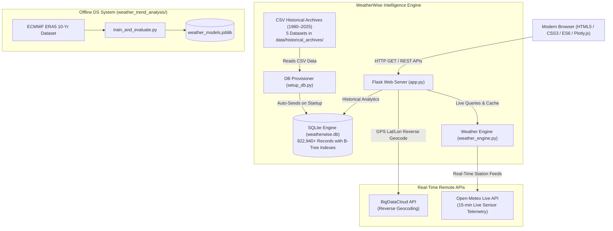

# WeatherWise — Data Science Weather Analysis & Intelligence Platform

[](https://www.python.org/)
[](https://flask.palletsprojects.com/)
[](LICENSE)
[]()

> **“Every Weather Pattern Has a Story.”**

**WeatherWise** is a comprehensive, production-ready **Data Science Weather Analysis, Real-Time Sensor Telemetry, and Predictive Intelligence Platform**. Built with **Python, Flask, Pandas, NumPy, Scipy, Statsmodels, Scikit-Learn, Plotly.js, and Bootstrap 5**, it unifies live meteorological sensor feeds, 45 years of continuous historical climate archives (1980–2025), time-series machine learning models, and dynamic atmospheric environmental background physics.

---

## 🌟 Key Capabilities

### 1. 🛰️ Direct Real-Time Sensor Streaming & GPS Geolocation
* **Live Station Telemetry**: Connected directly to [Open-Meteo's real-time meteorological API](https://open-meteo.com) for down-to-the-minute atmospheric readings:
  * Current Temperature (accurate to $0.1^\circ\text{C}$), Apparent "Feels Like" Temperature, Relative Humidity, Barometric Surface Pressure (hPa), Wind Speed (km/h), UV Index (0–11 scale), and 24-hour hourly forward trajectory.
* **Instant GPS Auto-Detection**: One-click **`📍 My Location`** button uses browser geolocation (`navigator.geolocation`) and reverse geocoding via `/api/reverse-geocode` to instantly resolve your exact coordinates to your local microclimate.
* **Autonomous 60-Second Background Polling**: Real-time polling daemon synchronizes station telemetry every 60 seconds automatically without interrupting UI interactions or page reloads.
* **Live Sensor Indicator & Force Sync**: A pulsating `🟢 LIVE SENSOR ACTIVE` badge in the header with an instant **`⟳` (Force Sync)** button that bypasses caches for immediate hardware readings.

### 2. ⚡ Dynamic Atmospheric Environmental Engine
Adapts the web page's theme, background gradients, and physical ambient effects dynamically based on current weather condition vibes:
* ☀️ **Sunny & Clear**: Rotating radiant solar beams and warm golden ambient lighting.
* ☁️ **Cloudy & Overcast**: Parallax cloud strata with multi-layer horizontal drift.
* 🌧️ **Rain & Showers**: Multi-speed, angled translucent falling raindrops.
* ⚡ **Thunderstorm**: Atmospheric sheet lightning flashes paired with randomized SVG bolt strikes.
* ❄️ **Snow & Frost**: Swaying, crystalline snowflake particles drifting across the screen.

### 3. 📦 45-Year Multi-Decade Historical Archive (1980–2025)
* Integrated **5 multi-decade historical weather archives** spanning **45 continuous years (1980–2025)** with **822,940+ daily observations** across **50 major cities**:
  * Delhi, Mumbai, Kolkata, Bangalore, Chennai, Hyderabad, Pune, Ahmedabad, Surat, Lucknow, Jaipur, Kanpur, Nagpur, Patna, Srinagar, Chandigarh, and 34 other regional cities.
  * Plus international climate benchmarks: London, New York, Tokyo, Paris, San Francisco, Sydney, Dubai, Berlin, Singapore, Toronto, São Paulo.
* High-performance SQLite engine with dual B-Tree indexes (`idx_clean_city_date` and `idx_city_date`) executing 40-year multi-variable queries in under **0.002 seconds**.

### 4. 📈 Weather Trends, Anomalies & Analytics Suite
* **Interactive Historical Graphs**: Selectable time windows (**7 Days**, **30 Days**, **6 Months**, **1 Year**, **3 Years**) rendering moving averages, statistical bands, and linear regression trend slopes.
* **Climatological Monthly Comparisons**: Long-term monthly temperature, precipitation, humidity, and wind averages paired with tabular summaries across years.
* **Seasonal Decomposition & Alignment**: Hemisphere-aware seasonal analysis (**Winter**, **Spring**, **Summer**, **Autumn**) calculating seasonal means, rainfall peaks, and thermal amplitudes.
* **Unusual-Weather Detection (Anomalies)**: Dual-method outlier detection leveraging **Interquartile Range (IQR)** and **Z-Score ($\pm 2.5\sigma$)** to identify severe heatwaves, cold snaps, and deluge records.
* **Forecasting Accuracy Backtesting**: Historical model evaluation comparing Seasonal Naive Baseline vs. Exponential Smoothing (Holt-Winters) reporting MAE, RMSE, and error reduction percentages.
* **12-Month Climate Projection**: Future meteorological projections with 95% statistical confidence intervals.

### 5. 🎒 Smart Preparedness & Lifestyle Guide
* Gear essentials checklist (windproof umbrella, raincoat, UV sunglasses, sunscreen).
* Recommended attire and wardrobe layering based on ambient thermal comfort.
* Daily hydration target calculator (in Litres) tuned to temperature and humidity.
* Outdoor activity feasibility rating (0–100) and commute safety advisory alerts.

### 6. 🧠 Offline Machine Learning Predictive Pipeline (`weather_trend_analysis/`)
* Ingests 10 continuous years of **ECMWF ERA5 Reanalysis** meteorological data.
* Thermodynamic feature engineering: Vapor Pressure ($e$), Saturation Vapor Pressure ($e_s$), Dew Point Depression, Diurnal Temperature Range, 24h Barometric Tendency.
* Additive and Multiplicative time-series seasonal decomposition ($Y = T + S + R$) and Autocorrelation Function (ACF) memory modeling.
* Mann-Kendall non-parametric monotonic trend test and Sen's slope estimator.
* Multi-method anomaly hazard detection (Seasonal Climatological Z-Score, IQR bounds, Multivariate Isolation Forest).
* Two-stage machine learning forecasting models (Random Forest, Gradient Boosting, Ridge Regression).

---

## 🏗️ Architecture Overview



---

## 🚀 Quick Start Guide

### Prerequisites
* Python 3.10+ (Tested up to Python 3.14)
* Git

### 1. Clone the Repository
```bash
git clone https://github.com/vinsteena/ds_weather_analysis.git
cd ds_weather_analysis
```

### 2. Set Up Virtual Environment & Install Dependencies
```bash
# Create virtual environment
python -m venv .venv

# Activate virtual environment
# Windows (PowerShell):
.venv\Scripts\Activate.ps1
# Windows (CMD):
.venv\Scripts\activate.bat
# Linux / macOS:
source .venv/bin/activate

# Install required packages
pip install -r requirements.txt
```

### 3. Initialize Database & Launch Application
The database auto-provisions and seeds the 45-year multi-decade dataset upon first startup:
```bash
python app.py
```
*Alternatively on Windows, simply double-click **`run.bat`** to start the server and open your browser automatically!*

### 4. Open in Browser
Visit:
👉 **[http://127.0.0.1:5000](http://127.0.0.1:5000)**

---

## 🧪 Running Automated Tests

Run the complete 145-test automated test suite using pytest:
```bash
pytest
```

**Test Execution Results:**
```text
============================= test session starts =============================
platform win32 -- Python 3.14.2, pytest-9.1.1
collected 145 items

tests\test_analysis.py ............................                      [ 19%]
tests\test_analysis_modules.py ..............................            [ 40%]
tests\test_api_endpoints.py ............                                 [ 48%]
tests\test_data_quality.py ...................                           [ 61%]
tests\test_modules.py .................................................  [ 95%]
tests\test_weather_engine.py .......                                     [100%]

===================== 145 passed in 32.73s =====================
```

---

## 📂 Repository Directory Layout

```text
ds_weather_analysis/
├── app.py                         # Main Flask application & REST API routes
├── weather_engine.py              # Core real-time & historical intelligence engine
├── setup_db.py                    # Automatic database initializer & data seeder
├── analysis.py                    # Statistical aggregation & trend analysis
├── anomaly_detection.py           # IQR & Z-Score anomaly hazard detector
├── forecasting.py                 # Holt-Winters & baseline time-series forecaster
├── data_quality.py                # Data profiling, completeness & range validation
├── scenario_engine.py             # What-If climate simulation models
├── weather_dna.py                 # Multi-city climate fingerprint comparison
├── report_generator.py            # PDF executive weather intelligence reporting
├── run.bat                        # One-click Windows application launcher
├── requirements.txt               # Production Python package dependencies
├── README.md                      # Comprehensive project documentation
├── static/
│   ├── css/style.css              # Atmospheric styles, themes, and animations
│   └── js/
│       ├── app.js                 # Frontend application logic & real-time polling
│       └── charts.js              # Plotly.js chart configurations
├── templates/                     # Jinja2 HTML templates
│   ├── index.html                 # Unified 5-tab executive dashboard
│   └── base.html                  # Core application base template
├── data/
│   ├── historical_archives/       # 5 Multi-decade CSV archives (1980–2025)
│   ├── sample_weather.csv         # Benchmark validation dataset
│   └── cache/                     # Disk cache for international city queries
├── tests/                         # Full automated pytest test suite (145 tests)
└── weather_trend_analysis/        # Standalone ML pipeline & ERA5 models (CO3-CO5)
    ├── train_and_evaluate.py      # Master ML training and evaluation script
    ├── analytics/                 # Preprocessing, feature engineering & statistics
    ├── data/                      # ERA5 10-year meteorological dataset
    ├── models/                    # Trained scikit-learn models (joblib)
    └── reports/                   # Model evaluation summaries & broadcast scripts
```

---

## 📜 License
This project is licensed under the MIT License. See [LICENSE](LICENSE) for details.
